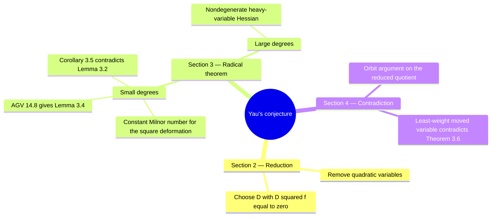

# Yau's Conjecture — Lean Companion

This repository accompanies Guorui Ma's paper, **[Non-existence of Negative Weight Derivations of the Moduli Algebras of Isolated Weighted Homogeneous Hypersurface Singularities](papers/Yau-Conjecture.pdf)**.

The paper proves that the moduli algebra of an isolated weighted homogeneous hypersurface singularity over the complex numbers has no nonzero derivation of negative degree. This repository formalizes its proof in Lean, taking **Theorem 14.8 of Arnold–Gusein-Zade–Varchenko (AGV), Volume 2, p. 415**, as an explicit hypothesis. Under this textbook input, the formal proof reaches the main theorem, including the reductions and the passage from polynomial to analytic Milnor algebras.

## What the theorem says

Let $`f`$ be weighted homogeneous with positive weights and an isolated critical point at the origin. Write $`\mathcal O=\mathbb C\lbrace x_1,\ldots,x_n\rbrace`$. Its Milnor algebra and moduli algebra are

```math
M_f=\mathcal O/(\partial_1f,\ldots,\partial_nf),\qquad T_f=\mathcal O/(f,\partial_1f,\ldots,\partial_nf).
```

Euler's identity identifies these two algebras. The main theorem is

```math
\mathrm{Der}_{\mathbb C}(M_f)_k=0\qquad\text{for every }k\lt0.
```

Here a derivation of degree $`k`$ sends the homogeneous component of degree $`j`$ into the component of degree $`j+k`$. Degrees throughout the guides are weighted degrees unless stated otherwise, as in the paper.

## How the proof works

**Section 2: reduce the polynomial and choose a derivation.** Weight-preserving coordinate changes remove the quadratic variables. Apart from the trivial algebra $`\mathbb C`$, this leaves $`f\in\mathfrak m^3`$ and $`d\gt2W`$, where $`W=\max_iw_i`$. If a nonzero negative-degree derivation exists, Proposition 2.4 chooses a polynomial lift $`D`$ satisfying $`D(J)\subseteq J`$ and $`D^2f=0`$.

**Section 3: rule out a homogeneous element in a selected radical.** For $`r\gt0`$, set $`I_r=(\partial_if:w_i\gt r)`$. Theorem 3.6 proves

```math
\sqrt{I_r}\cap S_r=\lbrace0\rbrace.
```

For $`3r\lt d`$, a hypothetical nonzero $`a`$ in this intersection gives a square deformation $`f+ta^2`$ of constant Milnor number. Lemma 3.4, using AGV's theorem, gives $`a^2\in J`$, while Lemma 3.2 gives $`a^2\notin J`$. For $`3r\ge d`$, a Hessian argument proves the radical statement directly.

**Section 4: obtain the contradiction.** The orbit argument makes $`D`$ act trivially on the reduced quotient by $`I_r`$. Choose a variable of least weight moved by $`D`$. Its nonzero image then lies in exactly the homogeneous part of $`\sqrt{I_r}`$ excluded by Theorem 3.6. This proves the result.

### Proof mind map



## Read the paper alongside the code

| Paper | What to understand | Lean modules |
| --- | --- | --- |
| Introduction; Appendix A | Weighted grading, Jacobian ideal, and the identification of polynomial and analytic Milnor algebras | [`Basic/`](RequestProject/Yau/Basic/), [`Appendix/`](RequestProject/Yau/Appendix/) |
| Section 2; Appendix B | Removal of quadratic variables, lifting, and the choice of $`D`$ | [`Sec2_Splitting/`](RequestProject/Yau/Sec2_Splitting/), [`Appendix/Lift.lean`](RequestProject/Yau/Appendix/Lift.lean) |
| Lemmas 3.1–3.3 | The Hessian argument, exclusion of squares, and constant Milnor number | [`Sec3_Radical/`](RequestProject/Yau/Sec3_Radical/) |
| Lemma 3.4; Corollary 3.5 | AGV's stratum description gives the first-order conclusion $`q\in J`$ | [`Final/AGV148.lean`](RequestProject/Yau/Final/AGV148.lean), [`Final/ThreeNewLocal.lean`](RequestProject/Yau/Final/ThreeNewLocal.lean), [`Versality/`](RequestProject/Yau/Versality/) |
| Theorem 3.6 | The radical statement for both ranges of $`r`$ | [`Sec3_Radical/Radical.lean`](RequestProject/Yau/Sec3_Radical/Radical.lean) |
| Section 4 | The orbit argument, the contradiction, and restoration of the original hypotheses | [`Sec4_Proof/`](RequestProject/Yau/Sec4_Proof/), [`Final/`](RequestProject/Yau/Final/) |

The **[proof guide](docs/Proof.md)** explains these steps in the paper's order, including how each output is used next. The **[code guide](docs/CodeGuide.md)** identifies the role of every Lean file. The **[textbook input](docs/AGV.md)** explains precisely how Theorem 14.8 enters Lemma 3.4. The code guide also explains directory names and abbreviations. For example, `AGV148.lean` refers to the textbook authors Arnold, Gusein-Zade, and Varchenko and their Theorem 14.8; it records the textbook statement used in this proof.

## Using the Lean project

The entry point is [`RequestProject/Yau.lean`](RequestProject/Yau.lean). The main theorem following the accompanying paper is `Yau.yau_conjecture_of_agv148` in [`Final/ThreeNewLocal.lean`](RequestProject/Yau/Final/ThreeNewLocal.lean). Its textbook hypothesis is described in the [code guide](docs/CodeGuide.md#main-theorem).

The project uses **Lean 4.28.0** and a pinned Mathlib dependency. From the repository root, with Lean available, run:

```sh
lake exe cache get
lake build
```

[`lean-toolchain`](lean-toolchain) selects Lean; [`lakefile.toml`](lakefile.toml) defines the library and dependency; [`lake-manifest.json`](lake-manifest.json) fixes the dependency revisions.

The [`papers/`](papers/) directory contains the accompanying paper and the AGV textbook. Their [reading notes](papers/README.md) give the relevant textbook pages.
